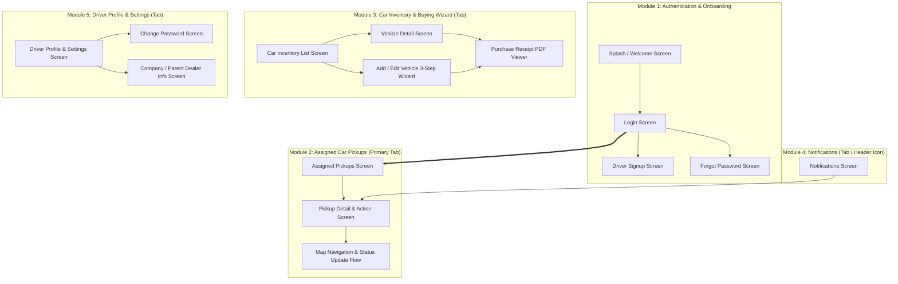

# AutoYard Driver App — Screen Planning & UI/UX Architecture

This document defines the complete screen architecture, UI component structure, navigation flow, and API endpoint mappings for the **AutoYard Driver Mobile / Web Application**.

---

## 1. High-Level App Structure & Navigation

The application is structured into **5 core modules** comprising **13–14 specialized screens** with a standard 4-tab bottom navigation bar for authenticated users.

---

## 2. Detailed Screen Planning by Module

---

### 🔐 Module 1: Authentication & Onboarding (3–4 Screens)

#### 1. Splash & Welcome Screen
- **Purpose:** App initialization, session/token validation (`Bearer <Token>`), redirecting to Home or Login.
- **UI Components:**
  - AutoYard Animated Logo & Branding.
  - Loading / Lottie indicator.
  - Auto-login check against local secure storage.

#### 2. Driver Login Screen
- **API Connected:** [`POST /auth/authenticate`](file:///Users/pixelz360/Desktop/api/auth/login.md)
- **UI Components:**
  - Email & Password input fields with validation.
  - Password visibility toggle.
  - "Remember Me" toggle.
  - "Forgot Password?" link.
  - "New Driver? Sign Up with Activation Key" link.
  - Primary "Log In" button.

#### 3. Driver Signup Screen
- **API Connected:** [`POST /auth/signup_driver`](file:///Users/pixelz360/Desktop/api/auth/signup.md)
- **UI Components:**
  - **Company Activation Key** input field (provided by employing business).
  - First Name & Last Name inputs.
  - Email Address & Phone Number inputs.
  - Password & Confirm Password inputs.
  - Terms & Privacy Agreement checkbox.
  - "Create Driver Account" submit button.

#### 4. Forgot Password & Verification Screen
- **APIs Connected:** 
  - [`POST /auth/forgot-password`](file:///Users/pixelz360/Desktop/api/auth/forgot_password.md)
  - [`POST /auth/resend-verification-email`](file:///Users/pixelz360/Desktop/api/auth/send_email_verification_link.md)
- **UI Components:**
  - Email address input.
  - "Send Reset Link" button.
  - Success feedback state with "Resend Link" countdown timer.

---

### 🚗 Module 2: Assigned Car Pickups (2 Screens — Primary Workflow)

#### 5. Assigned Pickups Screen *(Home / Tab 1)*
- **API Connected:** [`GET /assign_vehicle`](file:///Users/pixelz360/Desktop/api/assigned_car_pickup/all.md)
- **UI Components:**
  - **Top Date Filter / Calendar strip** (defaults to today `date=YYYY-MM-DD`).
  - **Status Filter Segment Control:** *All*, *Pending*, *Accepted*, *In Transit*, *Completed*, *Cancelled*.
  - **Pickup Summary Cards:**
    - Vehicle Year, Make, Model badge (e.g. `2000 Bentley Continental GT Speed`).
    - Customer Name & Phone Number.
    - Pickup Date & Scheduled Time.
    - Pickup Address snippet.
    - Agreed Price & Payment Method (`Cash` / `Bank Transfer`).
    - Status Badge with dynamic colors.
  - Pull-to-refresh & infinite scroll pagination.

#### 6. Pickup Detail & Status Action Screen
- **APIs Connected:** 
  - [`GET /assign_vehicle/{id}`](file:///Users/pixelz360/Desktop/api/assigned_car_pickup/single.md)
  - [`POST /assign_vehicle/status/{id}`](file:///Users/pixelz360/Desktop/api/assigned_car_pickup/status_update.md)
- **UI Components:**
  - **Customer Card:** Customer full name, phone number with quick **Call** & **SMS** action buttons.
  - **Location Card:** Full pickup address with **"Open in Google Maps / Apple Maps / Waze"** navigation button.
  - **Vehicle Specifications Card:** Year, Brand, Model, VIN, Engine, Transmission, Color.
  - **Payment & Financial Card:** Total purchase price, Payment mode, notes.
  - **Status Transition Action Footer:**
    - *Action Buttons:* "Accept Pickup", "Start Trip (In Transit)", "Arrived at Location", "Complete Pickup", or "Decline/Cancel".
    - Confirmation modals with optional driver note.

---

### 📋 Module 3: Car Inventory & Vehicle Wizard (4 Screens — Tab 2)

#### 7. Car Inventory List Screen
- **APIs Connected:** 
  - [`GET /vehicle`](file:///Users/pixelz360/Desktop/api/car_inventory/all.md)
  - [`POST /vehicle/delete/{id}`](file:///Users/pixelz360/Desktop/api/car_inventory/delete.md)
  - [`POST /vehicle/bulk_delete`](file:///Users/pixelz360/Desktop/api/car_inventory/bulk_delete.md)
- **UI Components:**
  - Search bar (by Rego, VIN, Make, Model, Seller name).
  - Sorting & filtering sheet (Date added, Price, Brand, Rego State).
  - Inventory item cards displaying:
    - Vehicle thumbnail photo / brand badge.
    - Rego Number + State pill (e.g. `ABC123 - ACT`).
    - Year, Make, Model, Odometer reading.
    - Price badge & purchase date.
  - Swipe actions (Delete, Edit, View Receipt).
  - Multi-select toggle for bulk deletion.
  - Floating Action Button (`+ Add Vehicle`).

#### 8. Add / Edit Vehicle Multi-Step Wizard (3 Steps)
- **APIs Connected:**
  - [`GET /vehicle/vehicle-details`](file:///Users/pixelz360/Desktop/api/car_inventory/get_vehicle_details_by_rego_number_state.md)
  - [`GET /vehicle/search-vehicle-details`](file:///Users/pixelz360/Desktop/api/car_inventory/search_vehicle_details_by_rego_number_state.md)
  - [`GET /vehicle/vin-decoder`](file:///Users/pixelz360/Desktop/api/car_inventory/get_vehicle_details_by_vin_no.md)
  - [`GET /brand`](file:///Users/pixelz360/Desktop/api/brand/all.md)
  - [`GET /model`](file:///Users/pixelz360/Desktop/api/model/all.md)
  - [`POST /vehicle/create`](file:///Users/pixelz360/Desktop/api/car_inventory/add.md)
  - [`POST /vehicle/update/{id}`](file:///Users/pixelz360/Desktop/api/car_inventory/update.md)

- **Step 1: Vehicle Lookup & Technical Specifications**
  - Registration Number & State input with **"Instant Auto-Fill"** button (queries Rego lookup API).
  - VIN Number input with **"Decode VIN"** button.
  - Cascading Brand & Model dropdown selectors.
  - Year, Engine Size, Engine Number, Body Type, Transmission, Variant, Built Date, Odometer.

- **Step 2: Seller & Pickup Information**
  - Owner First & Last Name, Phone Number, Date of Birth.
  - Australian Business Number (ABN) & Business Name (if commercial).
  - Driver License Number.
  - Residential Address & Pickup Address (with "Same as residential" toggle).
  - Scheduled Pickup Date picker.

- **Step 3: Vehicle Condition, Valuation & Signatures**
  - **Condition Assessment Switches (Yes/No):** Drivable, Accidental, WOVI (Written-Off Vehicle), Under Finance.
  - Agreed Purchase Price & Payment Method (`Cash`, `Bank Transfer`).
  - Driver Notes text area.
  - **Interactive Digital Signature Pad:**
    - Seller / Owner Signature Canvas.
    - Buyer / Driver Signature Canvas.
  - Terms & Declaration acceptance switch.
  - Submit / "Generate Receipt" button.

#### 9. Vehicle Detail Screen
- **API Connected:** [`GET /vehicle/{id}`](file:///Users/pixelz360/Desktop/api/car_inventory/single.md)
- **UI Components:**
  - Photo gallery header.
  - Vehicle overview chip list (Rego, State, VIN, Odometer, Year).
  - Full technical specification list.
  - Seller information & contact quick-dial.
  - Financial breakdown & Payment status.
  - Quick action toolbar: **View Receipt PDF**, **Edit Details**, **Delete**.

#### 10. Purchase Receipt PDF Viewer
- **API Connected:** [`GET /vehicle/purchase_receipt/{id}`](file:///Users/pixelz360/Desktop/api/car_inventory/purchase_receipt_pdf.md)
- **UI Components:**
  - High-resolution in-app PDF document renderer.
  - Zoom & Pan controls.
  - Top action bar: **Download PDF**, **Native System Share Sheet** (WhatsApp, Email, AirDrop), **Print**.

---

### 🔔 Module 4: Notifications (1 Screen — Tab 3 / App Header)

#### 11. Notifications Screen
- **APIs Connected:**
  - [`GET /notification`](file:///Users/pixelz360/Desktop/api/notifications/all_notifications.md)
  - [`POST /notification/mark_read/{id}`](file:///Users/pixelz360/Desktop/api/notifications/mark_as_read.md)
  - [`POST /notification/bulk_mark_read`](file:///Users/pixelz360/Desktop/api/notifications/bulk_mark_as_read.md)
- **UI Components:**
  - Notification items with distinct icons (New Vehicle Assigned, Pickup Rescheduled, System Notice).
  - Visual unread dot indicator.
  - Timestamp (e.g. `2 hours ago`, `Yesterday`).
  - Top button: **"Mark All as Read"**.
  - Tap-to-navigate (deep-links directly to the relevant Pickup or Vehicle detail).

---

### 👤 Module 5: Driver Profile & Settings (2–3 Screens — Tab 4)

#### 12. Driver Profile & Account Settings Screen
- **APIs Connected:**
  - [`GET /auth/get-user`](file:///Users/pixelz360/Desktop/api/auth/get_current_user.md)
  - [`POST /auth/account-settings`](file:///Users/pixelz360/Desktop/api/auth/account_setting.md)
  - [`POST /auth/logout`](file:///Users/pixelz360/Desktop/api/auth/logout.md)
- **UI Components:**
  - Profile Avatar with image picker / camera upload.
  - Driver full name, username, and driver role badge.
  - Editable form: First Name, Last Name, Phone Number.
  - Notification Dispatch Preference radio selector (`Email` vs `SMS`).
  - Employing Company quick card (links to Company Info).
  - "Change Password" navigation row.
  - App Version & Build number.
  - "Log Out" button with confirmation alert.

#### 13. Change Password Screen
- **API Connected:** [`POST /auth/change-password`](file:///Users/pixelz360/Desktop/api/auth/change_password.md)
- **UI Components:**
  - Current Password input.
  - New Password input with security strength meter.
  - Confirm New Password input.
  - "Update Password" button.

#### 14. Employing Company / Parent Dealer Info Screen *(Optional Modal)*
- **Data Source:** [`GET /auth/get-user`](file:///Users/pixelz360/Desktop/api/auth/get_current_user.md) (`driver_parent` & `driver_parent_details`)
- **UI Components:**
  - Company / Dealership Name & Logo.
  - Australian Business Number (ABN).
  - Business Email, Website, and Office Address.
  - Fleet / Vehicles quota and active subscription status.

---

## 3. Screen Matrix & API Mapping Summary

| # | Screen Name | Route / Path | Primary HTTP Method & API | Screen Type |
| :-: | :--- | :--- | :--- | :--- |
| **1** | Splash / Welcome | `/splash` | Local Token Check | Fullscreen |
| **2** | Login | `/login` | `POST /auth/authenticate` | Fullscreen |
| **3** | Driver Signup | `/signup` | `POST /auth/signup_driver` | Fullscreen / Stack |
| **4** | Forgot Password | `/forgot-password` | `POST /auth/forgot-password` | Fullscreen / Stack |
| **5** | Assigned Pickups | `/pickups` | `GET /assign_vehicle` | **Main Tab 1** |
| **6** | Pickup Detail & Action | `/pickups/:id` | `GET /assign_vehicle/{id}` `POST /assign_vehicle/status/{id}` | Stack Detail |
| **7** | Car Inventory List | `/inventory` | `GET /vehicle` `POST /vehicle/delete/{id}` | **Main Tab 2** |
| **8** | Add / Edit Vehicle Wizard | `/inventory/create` `/inventory/:id/edit` | `GET /brand`, `GET /model` `GET /vehicle/vehicle-details` `POST /vehicle/create` | Modal / Multi-step |
| **9** | Vehicle Detail | `/inventory/:id` | `GET /vehicle/{id}` | Stack Detail |
| **10** | Purchase Receipt PDF | `/inventory/:id/receipt` | `GET /vehicle/purchase_receipt/{id}` | Fullscreen Viewer |
| **11** | Notifications | `/notifications` | `GET /notification` `POST /notification/mark_read/{id}` | **Main Tab 3** |
| **12** | Driver Profile & Settings | `/profile` | `GET /auth/get-user` `POST /auth/account-settings` | **Main Tab 4** |
| **13** | Change Password | `/profile/change-password` | `POST /auth/change-password` | Stack Detail |
| **14** | Parent Company Info | `/profile/company` | `GET /auth/get-user` | Modal / Stack Detail |

---

## 4. Key UX & Technical Recommendations

1. **Offline Persistence & Queueing:**
   - In low-connectivity yards/depots, cache vehicle brands/models locally (`/brand` and `/model`).
   - Store digital signature PNGs locally until vehicle submission succeeds.
2. **One-Tap Rego / VIN Auto-Fill:**
   - On Step 1 of the vehicle wizard, typing the Rego & selecting State automatically fills Make, Model, Year, Engine, and Body Type via `GET /vehicle/vehicle-details`.
3. **Map & Calling Deep-Links:**
   - On the Pickup Detail screen, integrate `tel:<phone_number>` and `geo:<lat>,<lng>` / `https://maps.google.com/?q=<address>` to enable 1-tap calling and navigation for drivers on the road.
4. **JWT Session Lifecycle:**
   - Store the token securely (`SecureStore` in Expo / `Keychain` on iOS / `EncryptedSharedPreferences` on Android).
   - On 401 Unauthorized interceptor, seamlessly prompt the driver to re-authenticate without losing current form wizard state.
