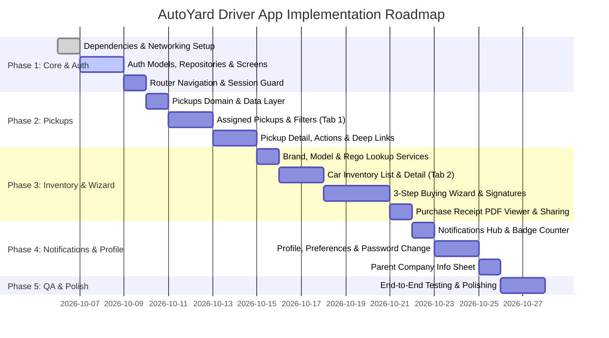

# AutoYard Driver Mobile App — Implementation Plan

This document outlines the end-to-end technical implementation plan for the **AutoYard Driver Mobile Application** (Flutter / iOS & Android), structured in accordance with [`APP_SCREEN_PLANNING.md`](file:///Users/pixelz360/Desktop/Boilerplate/APP_SCREEN_PLANNING.md), the 28 documented endpoints in [`api/README.md`](file:///Users/pixelz360/Desktop/Boilerplate/api/README.md), and the project's Clean Architecture standards.

---

## 1. Executive Summary & Architecture Blueprint

### 1.1 Technology Stack & Core Libs
- **Framework:** Flutter 3.x (Dart 3.x)
- **Architecture Pattern:** Feature-First Clean Architecture (`Data` ➔ `Domain` ➔ `Presentation`)
- **State Management & DI:** `flutter_riverpod` (v3) + Code Generation (`riverpod_generator`)
- **Routing & Navigation:** `go_router` with `ShellRoute` for 4-tab bottom navigation & authenticated redirection
- **Networking & API Client:** `dio` with `AuthInterceptor` (JWT Bearer Token), `LogInterceptor`, and `ApiExceptionHandler`
- **Immutable Models & Serialization:** `freezed` + `json_serializable`
- **Local Persistence & Caching:** `flutter_secure_storage` (Tokens) + `hive_flutter` (App cache, Brands, Models)
- **UI & Design Tokens:** `flutter_screenutil`, `flutter_svg`, token-based theme system in `lib/core/design/`

### 1.2 Base API Configuration
- **Live Base URL:** `https://dev.autoyard.com.au/api/v1`
- **Auth Strategy:** Bearer Token JWT injected via `AuthInterceptor` from secure storage.
- **Handling Known Backend Quirks:**
  - `POST /notification/bulk_mark_read` requires non-empty `ids` list payload (prevents 500 error).
  - `POST /vehicle/send_purchase_receipt/{id}` restricted by backend for drivers; in-app flow will utilize native PDF sharing/printing.

```mermaid
graph TD
    subgraph UI ["Presentation Layer"]
        Screens[Screens & Widgets]
        Controllers[Riverpod AsyncNotifiers & StateNotifiers]
    end

    subgraph Core ["Core / Shared"]
        Router[GoRouter & Guards]
        Theme[Design System Tokens]
        Network[Dio Client + Interceptors]
        Storage[Secure Storage / Hive]
    end

    subgraph Domain ["Domain Layer"]
        UseCases[Business Logic & Use Cases]
        Models[Freezed Domain Models & Entities]
        RepoInterfaces[Repository Interfaces]
    end

    subgraph Data ["Data Layer"]
        RepoImpl[Repository Implementations]
        RemoteDS[Remote Data Sources / Dio]
        LocalDS[Local Data Sources / Hive]
    end

    Screens --> Controllers
    Controllers --> UseCases
    UseCases --> RepoInterfaces
    RepoImpl ..|> RepoInterfaces
    RepoImpl --> RemoteDS
    RepoImpl --> LocalDS
    RemoteDS --> Network
    LocalDS --> Storage
    Screens --> Theme
    Router --> Controllers
```

---

## 2. Dependency Audit & Additions

To support all features identified in the screen planning (PDF viewing, native sharing, signatures, image capture), the following packages will be added to `pubspec.yaml`:

| Package | Purpose / Feature |
| :--- | :--- |
| `signature: ^5.5.0` | Driver and seller digital signature pads in the vehicle purchase wizard (Step 3) |
| `flutter_pdfview: ^1.4.0` / `syncfusion_flutter_pdfviewer` | High-fidelity purchase receipt PDF viewing with zoom/pan |
| `share_plus: ^10.1.4` | Native iOS/Android share sheet for sharing receipt PDFs |
| `cached_network_image: ^3.4.1` | Efficient image caching and loading for car inventory thumbnails and avatars |

---

## 3. Module-by-Module Implementation Breakdown

---

### 🔐 Module 1: Authentication & Onboarding

#### Screen Matrix & Routes
- **Splash Screen:** `AppRoutes.splash` (`/`)
- **Login Screen:** `AppRoutes.login` (`/login`)
- **Driver Signup Screen:** `AppRoutes.signup` (`/signup`)
- **Forgot Password Screen:** `AppRoutes.forgotPassword` (`/forgot-password`)

#### API Integrations
1. `POST /auth/authenticate` — Authenticate driver credentials & retrieve Bearer token.
2. `POST /auth/signup_driver` — Create driver account with required Company Activation Key.
3. `POST /auth/forgot-password` — Send reset password email.
4. `POST /auth/resend-verification-email` — Resend activation email link.
5. `GET /auth/get-user` — Hydrate driver profile and employing company/parent dealer info.

#### Key Deliverables
- [ ] Implement `DriverModel`, `ParentCompanyModel`, and auth request DTOs.
- [ ] Implement `AuthRemoteDataSource` replacing mock authentication with live endpoints.
- [ ] Token storage in secure keychain/storage with session auto-restore on splash.
- [ ] Validation-rich forms for activation key, email, password strength, and terms agreement.
- [ ] Unauthenticated / 401 interceptor redirection handling in `app_router.dart`.

---

### 🚗 Module 2: Assigned Car Pickups (Primary Tab 1)

#### Screen Matrix & Routes
- **Assigned Pickups Screen (Tab 1):** `AppRoutes.pickups` (`/pickups`)
- **Pickup Detail & Action Screen:** `AppRoutes.pickupDetail` (`/pickups/:id`)

#### API Integrations
1. `GET /assign_vehicle` (Supports query filters: `date=YYYY-MM-DD`, `orderby=id`, `order=DESC`, `page`, `perpage`).
2. `GET /assign_vehicle/{id}` — Fetch detailed pickup assignment specs, owner contacts, and location.
3. `POST /assign_vehicle/status/{id}` — Update trip status (`accepted`, `in_transit`, `completed`, `cancelled`).

#### Key Deliverables
- [ ] Implement `AssignedPickupModel`, `PickupCustomerModel`, `PickupVehicleModel`.
- [ ] Date filter strip (horizontal calendar picker) defaulting to current date.
- [ ] Status tab pills (`All`, `Pending`, `Accepted`, `In Transit`, `Completed`, `Cancelled`).
- [ ] Detail view with quick actions:
  - 1-Tap Phone Call (`url_launcher` `tel:`) & SMS launcher.
  - 1-Tap Navigation (`geo:` / Apple Maps / Google Maps / Waze deep link).
- [ ] Bottom action sheet with status transition workflow and driver note modal.

---

### 📋 Module 3: Car Inventory & Buying Wizard (Tab 2)

#### Screen Matrix & Routes
- **Car Inventory List (Tab 2):** `AppRoutes.inventory` (`/inventory`)
- **Add / Edit Vehicle 3-Step Wizard:** `AppRoutes.createVehicle` (`/inventory/create`), `AppRoutes.editVehicle` (`/inventory/:id/edit`)
- **Vehicle Detail Screen:** `AppRoutes.vehicleDetail` (`/inventory/:id`)
- **Purchase Receipt PDF Viewer:** `AppRoutes.purchaseReceipt` (`/inventory/:id/receipt`)

#### API Integrations
1. `GET /vehicle` — Fetch driver's vehicle inventory with pagination and search.
2. `GET /vehicle/{id}` — Fetch single vehicle full technical and purchase details.
3. `GET /vehicle/vehicle-details` & `GET /vehicle/search-vehicle-details` — Rego & State auto-lookup.
4. `GET /vehicle/vin-decoder` — VIN number decoder.
5. `GET /brand` & `GET /model` — Dynamic cascading brand and model dropdown lists.
6. `POST /vehicle/create` & `POST /vehicle/update/{id}` — Multi-part/JSON vehicle submission.
7. `POST /vehicle/delete/{id}` & `POST /vehicle/bulk_delete` — Individual and multi-select deletion.
8. `GET /vehicle/purchase_receipt/{id}` — Purchase receipt URL / stream generator.

#### Key Deliverables
- [ ] Implement `VehicleModel`, `BrandModel`, `VehicleModelOption`, `RegoLookupResultModel`.
- [ ] Multi-Step Buying Wizard:
  - **Step 1:** Instant Rego & State lookup auto-filling Year, Make, Model, VIN, Engine, Transmission; VIN decoder fallback; Brand/Model dropdowns.
  - **Step 2:** Seller name, contact, ABN, residential/pickup address toggles, scheduled date.
  - **Step 3:** Vehicle condition toggles (Drivable, Accidental, WOVI, Under Finance), agreed price, payment method, driver notes, interactive dual signature pad (Seller & Driver).
- [ ] Receipt PDF Viewer with zoom, pan, print, and native share sheet integration (`share_plus`).
- [ ] Swipe-to-delete and multi-select deletion in inventory list.

---

### 🔔 Module 4: Notifications (Tab 3 / Header)

#### Screen Matrix & Routes
- **Notifications Screen:** `AppRoutes.notifications` (`/notifications`)

#### API Integrations
1. `GET /notification` — Paginated list of notifications.
2. `POST /notification/mark_read/{id}` — Mark specific notification as read.
3. `POST /notification/bulk_mark_read` — Mark multiple or all notifications as read (payload formatted as `{ids: [...]}`).

#### Key Deliverables
- [ ] Implement `NotificationModel`.
- [ ] Notification badge count provider attached to bottom nav and header icons.
- [ ] Unread vs read styling with relative timestamp formatting (`timeago` / `intl`).
- [ ] "Mark All Read" action button with batch ID payload submission.
- [ ] Deep-linking from notification item directly to target Pickup (`/pickups/:id`) or Vehicle (`/inventory/:id`).

---

### 👤 Module 5: Driver Profile & Settings (Tab 4)

#### Screen Matrix & Routes
- **Driver Profile & Settings Screen:** `AppRoutes.profile` (`/profile`)
- **Change Password Screen:** `AppRoutes.changePassword` (`/profile/change-password`)
- **Parent Company / Dealership Screen:** `AppRoutes.companyInfo` (`/profile/company`)

#### API Integrations
1. `GET /auth/get-user` — Full profile and company details.
2. `POST /auth/account-settings` — Update profile info and dispatch preferences (`email` vs `sms`).
3. `POST /auth/change-password` — Change password with current and new password verification.
4. `POST /auth/logout` — Revoke token session and clear local secure cache.

#### Key Deliverables
- [ ] Profile form with Avatar image picker (`image_picker`).
- [ ] Dispatch preference selector (Email / SMS radio toggle).
- [ ] Change password form with instant validation meter.
- [ ] Parent dealership card displaying ABN, company email, address, and fleet quota.
- [ ] Clean logout dialog with token revocation and redirect to `/login`.

---

## 4. Phase-by-Phase Roadmap & Milestones



### Milestone Deliverables Summary
1. **Phase 1 (Foundation & Auth):** Live API client config (`https://dev.autoyard.com.au/api/v1`), secure token lifecycle, Login, Signup, Forgot Password, and Splash auto-login.
2. **Phase 2 (Assigned Pickups):** Tab 1 list with date strip, status filters, pickup detail screen with 1-tap call/maps navigation, and status transition sheet.
3. **Phase 3 (Car Inventory & Buying Wizard):** Tab 2 inventory browser, Step 1 (Rego/VIN lookup + Brand/Model cascading), Step 2 (Seller info), Step 3 (Condition, pricing, dual digital signature), and PDF receipt viewer.
4. **Phase 4 (Notifications & Profile):** Notifications tab with badge sync & bulk read, profile editing, dispatch toggle, password change, and company info modal.
5. **Phase 5 (Verification & Release Readiness):** End-to-end flow testing on iOS/Android simulator, offline cache resilience, and performance optimization.

---

## 5. Verification & Testing Strategy

1. **Unit & Domain Tests:**
   - Freezed DTO serialization/deserialization for all 28 API responses.
   - Riverpod controller state transitions and error state handling.
2. **Repository & Mock Tests:**
   - Network exception handling (`401 Unauthorized`, `404 Not Found`, `409 Conflict`, `422 Validation Error`).
3. **Integration & Manual UI Tests:**
   - Full authentication flow with test driver account (`fawaz.pixelz360@gmail.com`).
   - Pickup status flow verification (`Accepted` ➔ `In Transit` ➔ `Completed`).
   - Car buying wizard end-to-end execution (Rego auto-fill ➔ Signature capture ➔ Submission ➔ PDF viewing).
